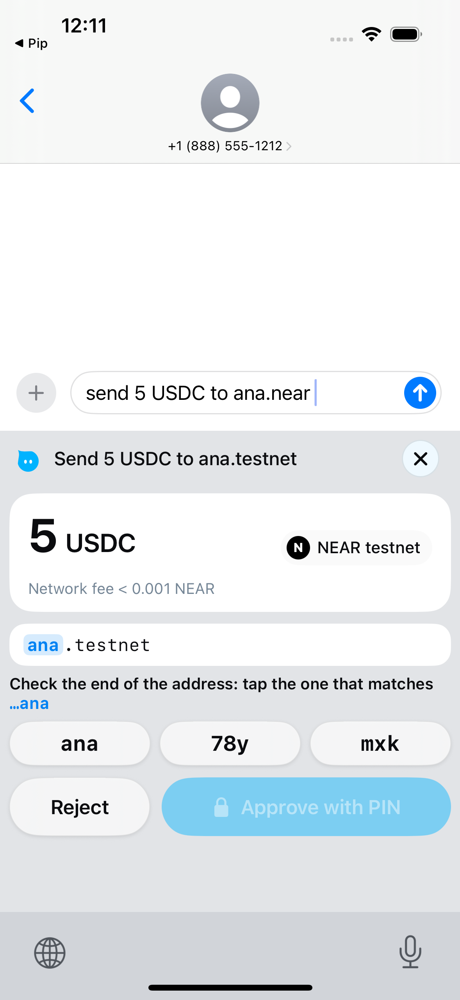
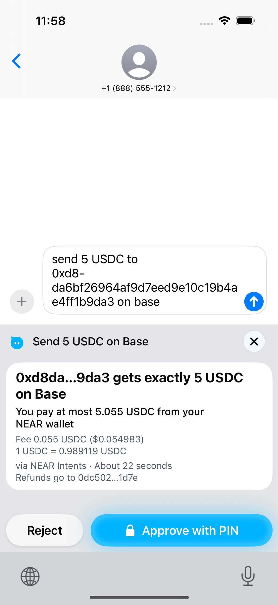

# Pip

**Do anything, anywhere.** Pip is an iOS keyboard and a companion app. It works in any app: Messages, Mail, Slack, Notes. As you type, it offers the next useful step: add a plan to your calendar, explain a topic with a drawing, rewrite a message, or pay someone on NEAR.

Private AI runs on NEAR AI Cloud. Payments run on NEAR, with keys held on your phone.

Built for NEAR HACKATHON. The repo started on 2026-11-12, inside the hackathon window.

## Try it

**TestFlight: https://testflight.apple.com/join/N35PJPEx**

Public beta: Apple is reviewing it. If the link says the beta isn't accepting testers yet, check back soon.

1. Install **TestFlight** from the App Store.
2. Open the link above on your iPhone.
3. Install **Pip**.
4. Go to **Settings → General → Keyboard → Keyboards → Add New Keyboard**. Add **Pip**, then turn on **Allow Full Access**.
5. Open the Pip app once.
6. Create a wallet. It uses **NEAR testnet**, so no real money moves.
7. Set a payment PIN.
8. Open any chat, switch to the Pip keyboard, and type.

Things to type:

- `dinner with Ana friday 7pm`
- `explain log function`
- `send 0.02 NEAR to pipfundmwg9zj4l.testnet` (a real testnet account; paste it)
- `send 5 USDC to 0x… on base`
- `swap 1 NEAR to USDC`

## Screens

| | | |
| --- | --- | --- |
| <br>Calendar in the keyboard: clash check and free times | <br>Explain + Draw it: a step-by-step drawing | <br>Private AI proof screen |
| <br>Send on NEAR: the card, approved with your PIN | <br>The PIN pad, inside the keyboard | <br>New address: check the whole address and tap its ending |
| <br>Pay USDC on Base through NEAR Intents | <br>"swap 1 near to usdc": a NEAR Intents swap preview | |

The shots come from the iOS simulator against the fake server (`npm run fake`). So the proof screen and the prices show fake values.

## NEAR integrations

### 1. Private AI on NEAR AI Cloud

- Rewrite and Explain run on NEAR AI Cloud models inside a TEE (Intel TDX with NVIDIA GPUs).
- The server checks the attestation for each model: a fresh nonce, the TDX quote and Intel certificate chain, the signing key, and a signature over each request and reply. Code: `server/src/nearai.ts`.
- Each reply carries `private`, `attested` and `model`. The app shows a "Private AI" mark and a proof screen.
- If NEAR fails, OpenRouter answers. The reply then says `private: false`.

### 2. A jev router on NEAR AI Cloud

- One jev question picks the action from what you type: calendar, reminder, pay, cross-chain pay, swap, request money, explain, rewrite, sums and more. Code: `server/src/route.ts`.
- jev is listed on NEAR AI Cloud and called there first. The phone's own parsers then read the amounts, dates and addresses.

### 3. Payments on NEAR, keys on the phone

- The phone holds an Ed25519 key. The server never holds a user key.
- The server builds the exact unsigned transaction. The phone signs it. The server checks the signature and broadcasts once.
- You approve in the keyboard with your Pip PIN.
- The server enforces per-payment and daily limits.
- Testnet is the default. Mainnet stays off unless `PAY_MAINNET=1`.

### 4. NEAR Intents (1Click)

- Pay any of 49 pinned tokens to any supported chain, from your NEAR account.
- Swap tokens, request money from any chain, and top up your wallet.
- On testnet, Pip shows live quote previews and does not send.
- Number safety, on every quote:
  - Amounts are integers in base units. Decimals belong to a (chain, contract) pair, never to a symbol.
  - Each price needs two agreeing sources.
  - The card shows the minimum the recipient gets.
  - A stale quote gets a fresh quote before you approve.
- Full rules: [docs/XCHAIN-NUMBERS.md](docs/XCHAIN-NUMBERS.md). Code: `server/src/pay/xchain/`.

### 5. Secret filter

- When the text looks like a key, a seed phrase or a password, the keyboard sends nothing to any AI.
- The bar says: "Sensitive text detected. AI is off."

### Real testnet transactions

- Phone-signed transfer: https://testnet.nearblocks.io/txns/Cbx3hEFg6EMsFzzC5Y3zLJoc6SeZq6rSYzMveUmPKnvv
- Transfer from the payment flow: https://testnet.nearblocks.io/txns/3BfzrmERiZg4YZUz3iP2f2MHX5konNMdHqUCbsWAfVLc

## Other features

- **Calendar panel.** Pip reads the time you typed, checks your calendar, warns about a clash and offers free times. Events stay on the phone.
- **Explain + Draw it.** Ask what something means. Pip answers in a line, then draws it step by step.
- **Rewrite and fix.** Shorten, fix grammar or change the tone of your message.
- **Sums.** Tips, splits, units and currency, worked out in the keyboard.

## Run locally

Needs macOS, Node 24+, Xcode 16+ and XcodeGen (`brew install xcodegen`).

### Server

No keys needed. The fake server uses a fake AI and a fake NEAR chain:

```sh
cd server
npm install
npm run fake
```

Real server:

```sh
cd server
npm install
cp ../.env.example ../.env   # fill in keys (table below)
npm run setup                # adds DATA_ENCRYPTION_KEY to ../.env
npm run dev                  # http://127.0.0.1:8787
```

Main env vars (in `.env` at the repo root, git-ignored):

| Name | Needed | What it does |
| --- | --- | --- |
| `DATA_ENCRYPTION_KEY` | yes | 64 hex chars. `npm run setup` makes it. |
| `TYPESAFE_API_KEY` | yes for `npm run dev` | jev, the router model. |
| `NEARAI_API_KEY` | for private AI | NEAR AI Cloud key. Turns on TEE inference and attestation. |
| `OPENROUTER_API_KEY` | fallback | Used when NEAR fails. Not private. |
| `NEARAI_MODEL_PRIMARY`, `NEARAI_MODEL_FALLBACK`, `NEARAI_JEV_MODEL` | no | Override the NEAR model ids. |
| `PAY_FUNDER_ACCOUNT_ID`, `PAY_FUNDER_PRIVATE_KEY` | for testnet pay | A funded `.testnet` account that seeds new wallets. |
| `PAY_MAINNET` | no | `1` allows mainnet. Off by default. |
| `NEAR_RPC_URL`, `NEAR_MAINNET_RPC_URL` | no | RPC overrides. |
| `ONECLICK_API_KEY` | no | Optional 1Click key. Not needed for quotes. |
| `PAY_MAX_*`, `XCHAIN_*` | no | Payment caps and cross-chain safety limits. |

### iOS

```sh
cd ios
xcodegen
open Pip.xcodeproj
```

Pick the **Pip** scheme and an iPhone simulator. Debug builds talk to `http://localhost:8787`.

## Tests

- **Server:** `cd server && npm test`. On 2026-11-14: 246 tests, 246 pass, 0 fail.
- **iOS:** 376 unit tests in `ios/Tests` and 39 UI tests in `ios/UITests`. Run them from Xcode (Product → Test).

## Honest limits

- **No key backup or recovery yet.** The wallet key lives only on this phone.
- **Uninstalling the app deletes the wallet key**, and any money in it.
- **The keyboard uses a PIN, not Face ID.** iOS does not let Face ID run inside a keyboard.
- **No cross-chain mainnet send proven live yet.** The cross-chain flow is tested with a fake 1Click and previewed on testnet.
- **jev on NEAR is not TEE-attested.** It is listed on NEAR AI Cloud, but it does not run in a TEE. Qwen, the main writing model, is attested.
- **Attestation gaps.** No Intel TCB or revocation check, no NVIDIA GPU evidence, no allowlist of builds. Pip's server sees text before it reaches the TEE.

More: [server/SECURITY.md](server/SECURITY.md), [docs/DATA.md](docs/DATA.md), [docs/XCHAIN-NUMBERS.md](docs/XCHAIN-NUMBERS.md).

## Licence

Licence: MIT (see LICENSE)
