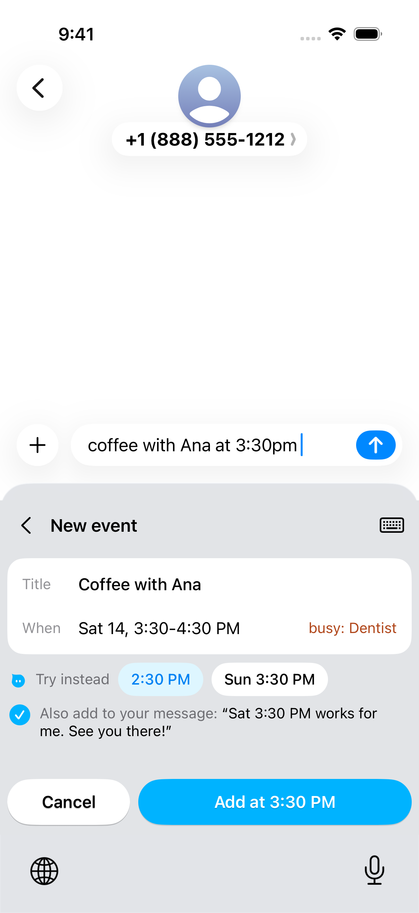
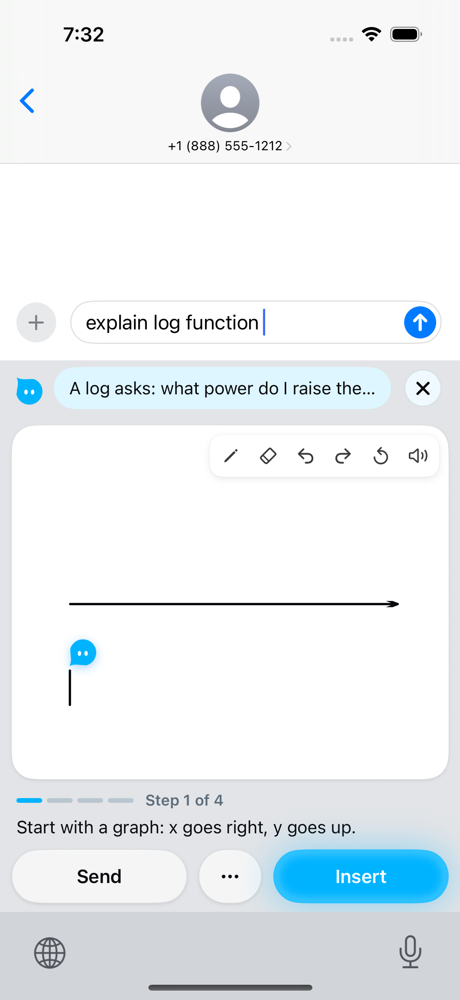
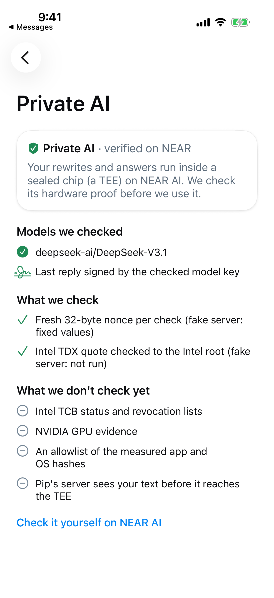
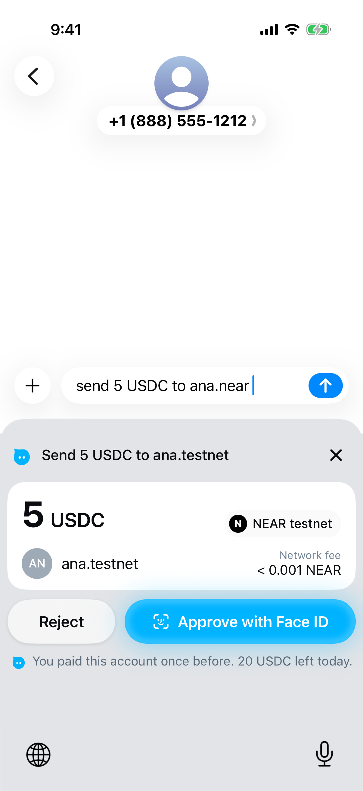
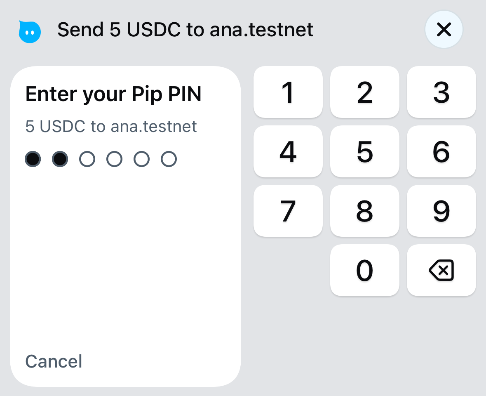
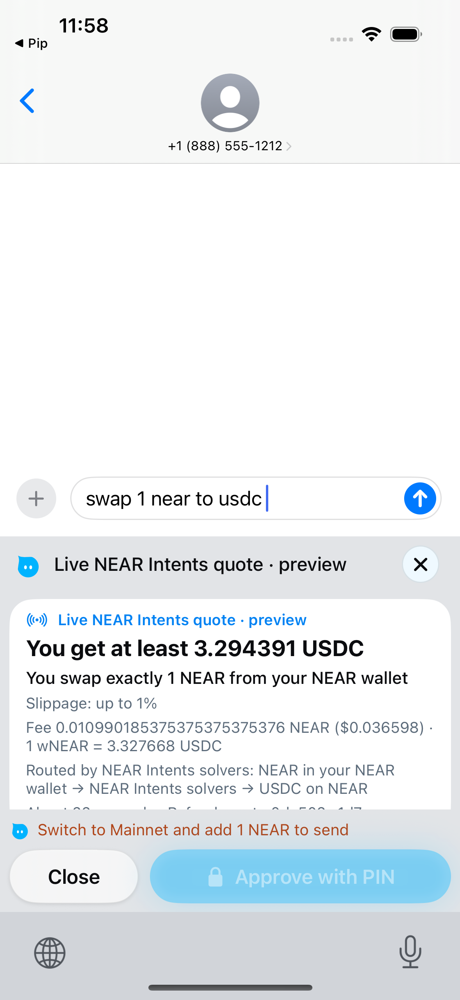

# Pip

**Do anything, anywhere.** Pip is an iOS keyboard and a companion app. It works in any app: Messages, Mail, Slack, Notes. As you type, it offers the next useful step: add a plan to your calendar, explain a topic with a drawing, rewrite a message, or pay someone on NEAR.

Private AI runs on NEAR AI Cloud. Payments run on NEAR, with keys held on your phone.

Built for NEAR HACKATHON. The repo started on 2026-11-12, inside the hackathon window.

**Demo video (2 min): https://x.com/thatasssixr/status/2121687953751576844**

## For judges: a 2-minute check

No keys and no wallet needed:

```sh
cd server && npm install
npm test                     # 246 tests
npm run quote -- "send 5 usdc to 0xd8dA6BF26964aF9D7eEd9e03E53415D37aA96045 on base"
```

`npm run quote` asks NEAR Intents (1Click) for a live, dry quote. It reads the typed text, checks the token against Pip's verified contract pins, converts the amount to exact base units for that chain's decimals, and checks that the recipient gets exactly what you typed. Nothing is signed and no money moves.

## What makes Pip different

- **You approve inside the keyboard.** Type the payment, enter your PIN, done. You never leave the chat for a wallet app.
- **The key stays on your phone.** Pip makes a NEAR key on the device and seals it with your PIN (PBKDF2 + AES-GCM) in the iOS keychain. The server never holds it. The phone checks each transaction before it signs. In the app, Face ID guards the key. In the keyboard, you approve with your PIN, because iOS does not let Face ID run inside a keyboard.
- **Private AI you can check.** The server verifies the TEE attestation of the NEAR AI Cloud model, not just its name.
- **Learn anything, drawn live.** Type `explain compound interest` or `explain log function`. Pip answers in one line, then draws it step by step in real time on an Excalidraw canvas inside the keyboard. The private AI on NEAR AI Cloud writes the scene.
- **Calendar and reminders from any chat.** Type `dinner with Ana friday 7pm` and Pip offers to add it to your calendar, with a clash check. Type `remind me to call mom at 6pm` and it adds an iOS reminder. Nothing is saved until you tap.
- **A secret filter.** Passwords, private keys and seed phrases never reach any AI. You can still type and send them.
- **One router for every action.** jev on NEAR AI Cloud reads what you type and picks the action. There are no fixed keyword triggers.

## Try it

**TestFlight: https://testflight.apple.com/join/N35PJPEx**

Public beta: Apple is reviewing it. If the link says the beta isn't accepting testers yet, check back soon.

1. Install **TestFlight** from the App Store.
2. Open the link above on your iPhone.
3. Install **Pip**.
4. Go to **Settings → General → Keyboard → Keyboards → Add New Keyboard**. Add **Pip**, then turn on **Allow Full Access**.
5. Open the Pip app once.
6. Create a wallet. It starts on **NEAR testnet**, so no real money moves. Mainnet is live too: switch in Pip Pay.
7. Set a payment PIN.
8. Open any chat, switch to the Pip keyboard, and type.

Things to type:

- `dinner with Ana friday 7pm`
- `remind me to call mom at 6pm`
- `explain log function`
- `send 0.02 NEAR to pipfundmwg9zj4l.testnet` (a real testnet account; paste it)
- `send 5 USDC to 0x… on base`
- `swap 1 NEAR to USDC`

## Screens

| | | |
| --- | --- | --- |
| <br>Calendar in the keyboard: clash check and free times | <br>Explain + Draw it: a step-by-step drawing | <br>Private AI proof screen |
| <br>Send on NEAR: the card, approved with your PIN | <br>The PIN pad, inside the keyboard | <br>New address: check the whole address and tap its ending |
| <br>Pay USDC on Base through NEAR Intents | <br>"swap 1 near to usdc": a NEAR Intents swap preview | |

The shots come from the iOS simulator against the fake server (`npm run fake`). So the proof screen and the prices show fake values.

## NEAR integrations

### 1. Private AI on NEAR AI Cloud

- Rewrite and Explain run on NEAR AI Cloud models inside a TEE (Intel TDX with NVIDIA GPUs).
- The server checks the attestation for each model: a fresh nonce, the TDX quote and Intel certificate chain, the signing key, and a signature over each request and reply. Code: `server/src/nearai.ts`.
- Each reply carries `private`, `attested` and `model`. The app shows a "Private AI" mark and a proof screen.
- If NEAR fails, OpenRouter answers. The reply then says `private: false`.

### 2. A jev router on NEAR AI Cloud

- One jev question picks the action from what you type: calendar, reminder, pay, cross-chain pay, swap, request money, explain, rewrite, sums and more. Code: `server/src/route.ts`.
- jev is listed on NEAR AI Cloud and called there first. The phone's own parsers then read the amounts, dates and addresses.

### 3. Payments on NEAR, keys on the phone

- The phone holds an Ed25519 key. The server never holds a user key.
- The server builds the exact unsigned transaction. The phone signs it. The server checks the signature and broadcasts once.
- You approve in the keyboard with your Pip PIN.
- The server enforces per-payment and daily limits.
- **Testnet and mainnet are both live.** New wallets start on testnet. Switch to mainnet in Pip Pay to send real money.
- Mainnet has small caps: 2 NEAR or 10 USDC/USDT per payment, and 5 NEAR or 20 USDC/USDT a day.

### 4. NEAR Intents (1Click)

- Pay any of 49 pinned tokens to any supported chain, from your NEAR account.
- Swap tokens, request money from any chain, and top up your wallet.
- On testnet, Pip shows live quote previews and does not send.
- Live mainnet quotes from NEAR Intents: `npm run quote -- "send 5 usdc to 0x… on base"`. The full send flow (quote, check, sign, deposit, status) runs in the server tests.
- Number safety, on every quote:
  - Amounts are integers in base units. Decimals belong to a (chain, contract) pair, never to a symbol.
  - Each price needs two agreeing sources.
  - The card shows the minimum the recipient gets.
  - A stale quote gets a fresh quote before you approve.
- Full rules: [docs/XCHAIN-NUMBERS.md](docs/XCHAIN-NUMBERS.md). Code: `server/src/pay/xchain/`.

### 5. Secret filter

- When the text looks like a key, a seed phrase or a password, the keyboard sends nothing to any AI.
- The bar says: "Sensitive text detected. AI is off."

### Real testnet transactions

- Phone-signed transfer: https://testnet.nearblocks.io/txns/Cbx3hEFg6EMsFzzC5Y3zLJoc6SeZq6rSYzMveUmPKnvv
- Transfer from the payment flow: https://testnet.nearblocks.io/txns/3BfzrmERiZg4YZUz3iP2f2MHX5konNMdHqUCbsWAfVLc

## Other features

- **Calendar panel.** Pip reads the time you typed, checks your calendar, warns about a clash and offers free times. Events stay on the phone.
- **Explain + Draw it.** Learn about anything. Ask what something means. Pip answers in a line, then draws it step by step, live, on an Excalidraw canvas in the keyboard.
- **Rewrite and fix.** Shorten, fix grammar or change the tone of your message.
- **Sums.** Tips, splits, units and currency, worked out in the keyboard.

## Run locally

Needs macOS, Node 24+, Xcode 16+ and XcodeGen (`brew install xcodegen`).

### Server

No keys needed. The fake server uses a fake AI and a fake NEAR chain:

```sh
cd server
npm install
npm run fake
```

Real server:

```sh
cd server
npm install
cp ../.env.example ../.env   # fill in keys (table below)
npm run setup                # adds DATA_ENCRYPTION_KEY to ../.env
npm run dev                  # http://127.0.0.1:8787
```

Main env vars (in `.env` at the repo root, git-ignored):

| Name | Needed | What it does |
| --- | --- | --- |
| `DATA_ENCRYPTION_KEY` | yes | 64 hex chars. `npm run setup` makes it. |
| `TYPESAFE_API_KEY` | yes for `npm run dev` | jev, the router model. |
| `NEARAI_API_KEY` | for private AI | NEAR AI Cloud key. Turns on TEE inference and attestation. |
| `OPENROUTER_API_KEY` | fallback | Used when NEAR fails. Not private. |
| `NEARAI_MODEL_PRIMARY`, `NEARAI_MODEL_FALLBACK`, `NEARAI_JEV_MODEL` | no | Override the NEAR model ids. |
| `PAY_FUNDER_ACCOUNT_ID`, `PAY_FUNDER_PRIVATE_KEY` | for testnet pay | A funded `.testnet` account that seeds new wallets. |
| `PAY_MAINNET` | no | `1` allows mainnet. Off by default. |
| `NEAR_RPC_URL`, `NEAR_MAINNET_RPC_URL` | no | RPC overrides. |
| `ONECLICK_API_KEY` | no | Optional 1Click key. Not needed for quotes. |
| `PAY_MAX_*`, `XCHAIN_*` | no | Payment caps and cross-chain safety limits. |

### iOS

```sh
cd ios
xcodegen
open Pip.xcodeproj
```

Pick the **Pip** scheme and an iPhone simulator. Debug builds talk to `http://localhost:8787`.

## Tests

- **Server:** `cd server && npm test`. On 2026-11-14: 246 tests, 246 pass, 0 fail.
- **iOS:** 376 unit tests in `ios/Tests` and 39 UI tests in `ios/UITests`. Run them from Xcode (Product → Test).

## What's next

- **Merlin: an always-watching agent for your computer.** It watches everything that happens on your computer. It spots when something is about to leak, like a password, a private key or a seed phrase, and when you need help. Then it helps on its own, or asks you first. It runs on private AI and tells no one what it sees.
- **Multi-signature wallets, coming soon.** Your phone key signs first, and a passkey gives the second signature for bigger payments.
- **Key backup and recovery.** Today the wallet key lives only on your phone, by design. Uninstalling the app deletes it.
- **jev inside a TEE.** jev runs on NEAR AI Cloud; Qwen, the main writing model, is already TEE-attested.
- **Deeper attestation.** Add the Intel TCB and revocation check, NVIDIA GPU evidence, and an allowlist of builds.
- **Encryption straight to the TEE**, so Pip's own server never sees the text.

More: [server/SECURITY.md](server/SECURITY.md), [docs/DATA.md](docs/DATA.md), [docs/XCHAIN-NUMBERS.md](docs/XCHAIN-NUMBERS.md).

## Licence

Licence: MIT (see LICENSE)
