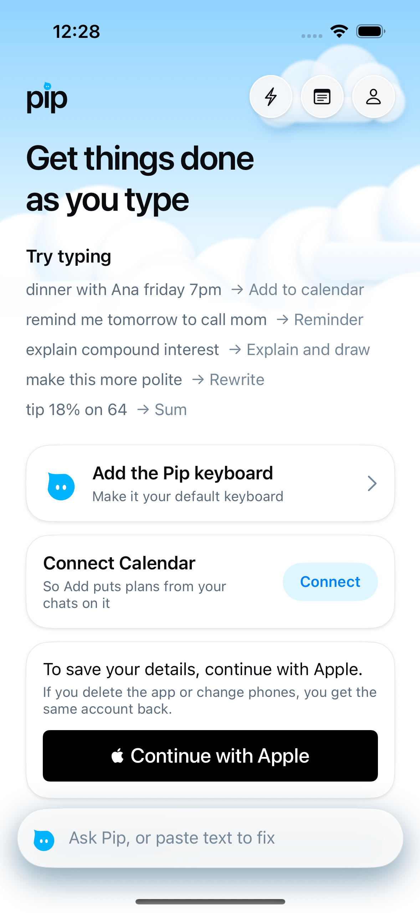
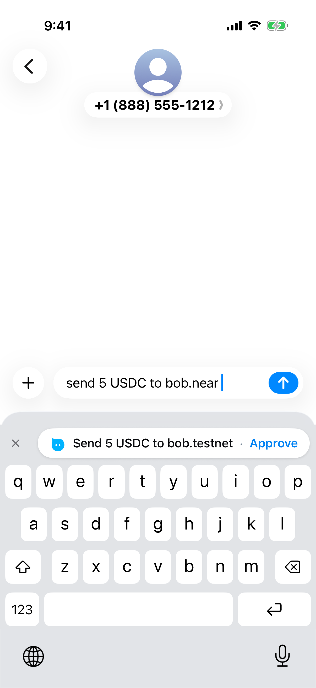
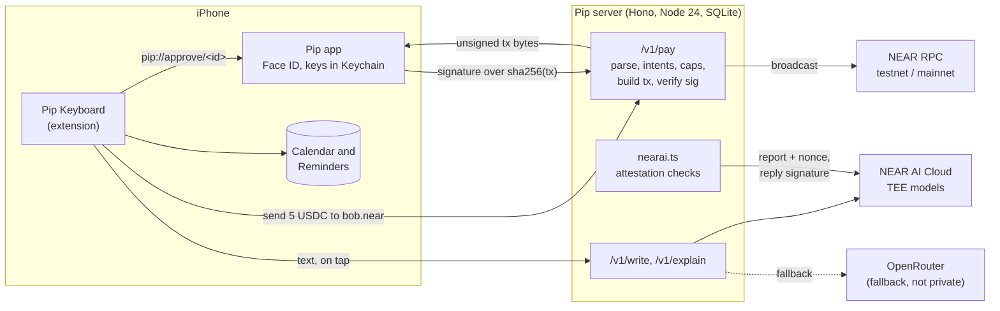

# Pip

**Pip: an iOS keyboard that does anything, anywhere — with private AI and self-custodial payments on NEAR.**

Pip is a keyboard for iPhone. It works in any app: Messages, Mail, Slack, Notes. As you type, it offers the next useful step. It adds plans to your calendar, rewrites a message, explains a topic with a drawing, and sends money on NEAR.

Built for NEAR HACKATHON (2026-11-01 to 2026-11-14). Tracks: Privacy & Private AI, Real-World Money, Agent Economy, Open Innovation.

## What it does

| | |
| --- | --- |
|  | **Helper actions in any chat.** Type "dinner with Ana friday 7pm" and tap to add it to your calendar. "remind me tomorrow to call mom" becomes a reminder. "tip 18% on 64" shows the sum, with no network. |
|  | **Calendar in the keyboard.** Pip reads the time you typed and checks your calendar. It warns you about a clash, offers free times, and can add "Sat 3:30 PM works for me" to your message. Events stay on the phone. |
|  | **Private AI on NEAR.** Rewrite and Explain run on NEAR AI Cloud, inside a TEE (a sealed chip). The server checks NEAR's hardware proof. The app shows a "Private AI" mark and a proof screen that lists what we check and what we do not check yet. |
|  | **Type to pay.** Type "send 5 USDC to bob.near" in any chat. Pip shows a chip. A first payment to someone opens the Pip app. A repeat payment, under your daily limit, stays in the keyboard. |
|  | **Approve with Face ID.** The card shows the exact amount, token, recipient and network. You approve or reject. Pip then types the explorer link into your message (`docs/shots/near-inserted.png`). |

The screenshots come from the iOS simulator against `npm run fake` (a fake AI and a fake NEAR chain). So the proof screen shows fake values ("fake server: not run"), and the tx link in `near-inserted.png` is not a real hash. A real testnet tx is linked under "How to verify".

## NEAR integration

### 1. Private AI on NEAR AI Cloud (TEE)

- With `NEARAI_API_KEY` set, the server sends writing help and explanations to NEAR AI Cloud (`https://cloud-api.near.ai/v1`).
- Default models: `Qwen/Qwen3.6-35B-A3B-FP8` (first) and `z-ai/glm-5.3-flash` (backup). Both run on NEAR's GPUs inside a TEE (Intel TDX with NVIDIA GPUs).
- The server refuses Claude and GPT model ids at start-up.
- If NEAR fails or has no key, OpenRouter answers instead (`OPENROUTER_API_KEY`). The reply then says `private: false`.
- Every reply from `/v1/write/*` and `/v1/explain*` carries `private`, `attested` and `model`.

What the server checks (`server/src/nearai.ts`, Node crypto only, no extra library):

1. It makes a fresh 32-byte nonce. It calls `GET /v1/attestation/report?model=…&signing_algo=ecdsa&nonce=…`.
2. For the gateway and each model, it checks the Intel TDX quote: the quote signature, the QE report, and the PCK certificate chain up to Intel's root CA (pinned by fingerprint).
3. It requires the signing address and our nonce in the report data. It requires the debug bit off, MRCONFIGID equal to the hash of `app_compose`, and RTMR3 equal to the replayed event log.
4. After each reply, it fetches `GET /v1/signature/<chat id>`. It requires an EIP-191 signature from the attested model key over the SHA-256 of the exact request and response.

A model counts as `attested` for 10 minutes after a check passes. Replies never wait for a check, so a cold model reads `attested: false` at first.

What it does **not** check yet:

- Intel TCB status and revocation lists.
- NVIDIA GPU evidence.
- An allowlist of known good builds (measured app and OS hashes).
- Pip's own server sees your text before it reaches the TEE. So the text is private from NEAR and the model host, not from Pip.
- The tone check uses Typesafe jev, which runs outside a TEE. Its replies say `private: false`.

### 2. Type-to-pay on NEAR

Two custody paths live in `server/src/pay/`. Full design: `server/SECURITY.md`.

**Phone-held keys (default, testnet and mainnet), `server/src/pay/phone/`.**

- The phone holds an Ed25519 key. The account is the key's implicit account (64 hex chars).
- The server never holds a user key. It has no mainnet key at all.
- The server builds the exact unsigned transaction: a `Transfer`, or a USDC `ft_transfer` (with `storage_deposit` first when the recipient needs it).
- The phone signs `sha256(tx)`. The server checks the signature against the registered key and the stored bytes. Then it broadcasts once.
- Testnet is the default. Mainnet is off unless `PAY_MAINNET=1`. The RPC must report the matching `chain_id` before any broadcast.

**Limits, enforced on the server inside one SQLite transaction:**

- Per payment and per rolling day. Testnet: 1 NEAR / 2 NEAR a day, 10 USDC / 25 USDC a day. Mainnet: 2 NEAR / 5 NEAR a day, 10 USDC / 20 USDC a day. All are env vars.
- Known-recipient rule: the keyboard alone can pay only someone you already paid. A new recipient always opens the Pip app.
- Each payment request (intent) lasts 10 minutes and works once. A second submit returns the first result.

**Keyboard pay (design C).** One-time setup in the app gives the keyboard its own capped key. With it, the keyboard can approve a repeat payment, under the keyboard's daily limit, with Face ID. Anything else answers `needs_app` and opens the app.

**Honest state of the iOS app.** The phone-signed flow is done and tested on the server (`server/test/pay-phone.test.ts`, 10 tests). `server/scripts/mainnet-sign-demo.ts` plays the phone from a terminal: `example` builds and signs a tx offline, and `send` runs the full flow on mainnet (real money, so it needs `PIP_CONFIRM_MAINNET=yes`). The iOS app does not sign on the phone yet. It still uses the older server-held testnet path, so the app's pay screens need `PAY_LEGACY_CUSTODY=1`. On that path the server holds a demo testnet key per user. Testnet tokens have no value. See "Limits and honest gaps".

## Architecture



## Run it locally

Needs macOS, Node 24+, Xcode 16+, and XcodeGen (`brew install xcodegen`).

### Fastest path: no keys

The fake server runs the whole app with a fake AI and a fake NEAR chain. It needs no API keys and no network.

```sh
cd server
npm install
PORT=8799 PAY_LEGACY_CUSTODY=1 npm run fake
# prints: fake pip on http://127.0.0.1:8799  token pkd_fake
```

Check it in a second terminal:

```sh
curl -s localhost:8799/v1/ai/attestation -H 'authorization: Bearer pkd_fake'
curl -s -X POST localhost:8799/v1/pay/parse -H 'authorization: Bearer pkd_fake' \
  -H 'content-type: application/json' -d '{"text":"send 0.5 NEAR to ana.testnet"}'
```

You should see `"attested":true` and `{"valid":true,"amount":"0.5","token":"NEAR","recipient":"ana.testnet",…}`.

### Real server

```sh
cd server
npm install
cp ../.env.example ../.env   # then fill in your keys (table below)
npm run setup                # adds DATA_ENCRYPTION_KEY to ../.env (never printed)
npm run dev                  # http://127.0.0.1:8787
```

Env vars (in `.env` at the repo root; it is git-ignored):

| Name | Needed | What it does |
| --- | --- | --- |
| `DATA_ENCRYPTION_KEY` | yes | 64 hex chars. `npm run setup` makes it. |
| `TYPESAFE_API_KEY` | yes for `npm run dev` | Typesafe jev, the small intent and tone model. Runs outside a TEE. |
| `NEARAI_API_KEY` | for private AI | NEAR AI Cloud key from https://cloud.near.ai. Turns on TEE inference and attestation. |
| `OPENROUTER_API_KEY` | fallback | Used when NEAR fails or has no key. Not private. Set at least one of the two. |
| `NEARAI_MODEL_PRIMARY`, `NEARAI_MODEL_FALLBACK` | no | Override the two TEE models. |
| `PAY_FUNDER_ACCOUNT_ID`, `PAY_FUNDER_PRIVATE_KEY` | for testnet pay | A funded `.testnet` account. It gives each new wallet 0.2 testnet NEAR. Without it, wallet routes answer 503. |
| `PAY_LEGACY_CUSTODY` | `1` for the current iOS app | Turns on the older server-held testnet path the app still calls. |
| `PAY_MAINNET` | no | `1` allows mainnet. Off by default. The server holds no mainnet key. |
| `NEAR_RPC_URL`, `NEAR_MAINNET_RPC_URL` | no | Defaults: `https://test.rpc.fastnear.com`, `https://free.rpc.fastnear.com`. |
| `PAY_MAX_PER_TX_*`, `PAY_MAX_DAILY_*`, `PAY_MAINNET_MAX_*` | no | Payment caps (see above). |
| `RESEND_API_KEY`, `MAIL_FROM` | no | Email sign-in codes. Without them, email is off. |

### Tests

```sh
cd server
npm test          # 202 tests, 0 failures (run on 2026-11-14)
npm run typecheck
```

NEAR tests: `test/nearai.test.ts` (attestation checks against a real recorded NEAR report in `test/fixtures/near-attestation.json`, plus tampered copies), `test/pay.test.ts`, `test/pay-phone.test.ts`.

### iOS app (simulator)

```sh
cd ios
xcodegen
open Pip.xcodeproj
```

1. Pick the **Pip** scheme and an iPhone 16 Pro simulator. Debug builds talk to `http://localhost:8787`.
2. To use the fake server instead, start it as above, run the app once, then pair:
   `xcrun simctl openurl booted "pip-dev://pair?token=pkd_fake&server=http://127.0.0.1:8799"`
3. In Settings > General > Keyboard > Keyboards, add **Pip Keyboard** and turn on Full Access.
4. Open Messages and type with the Pip keyboard.

The UI tests that made the screenshots are in `ios/UITests/` (`CalendarShots`, `PayShots`, `SmartChipShots`). `PayShots` needs Face ID enrolled on the simulator; its header comment explains how.

The drawing page in `ios/Visual` is prebuilt. To rebuild it: `cd visual && npm install && npm run build`.

## How to verify

Do X, see Y:

1. **Server tests.** `cd server && npm test`. See `pass 202`, `fail 0`.
2. **Attestation checks.** `node --test test/nearai.test.ts`. See a real NEAR report pass every check, and a wrong nonce, signer, config, event or quote byte fail.
3. **Attestation endpoint.** With `NEARAI_API_KEY` set and `npm run dev` running, sign in and call `GET /v1/ai/attestation`. See each model's result, the steps checked, the last reply signature, and the "not checked yet" list. With the fake server, use the curl above.
4. **Check a reply yourself.** Take a reply's chat id and paste it into https://cloud.near.ai/verify.
5. **Phone-signing, offline.** `PIP_DEMO_KEY_FILE=/tmp/pip-demo-key.json node scripts/mainnet-sign-demo.ts example`. See an unsigned USDC transfer (`storage_deposit` + `ft_transfer`), its hash, an Ed25519 signature, and `"signature_ok": true`. Nothing is sent.
6. **Live testnet payment.** With a funded `.testnet` funder in `.env`:
   `cd server && PAY_LEGACY_CUSTODY=1 node --env-file=../.env scripts/pay-testnet-demo.ts`.
   See parse, wallet, intent and approve calls, then a tx hash. The second approve returns the first result and does not send again.
7. **A real testnet transfer** from this flow: https://testnet.nearblocks.io/txns/3BfzrmERiZg4YZUz3iP2f2MHX5konNMdHqUCbsWAfVLc (0.01 NEAR from a Pip wallet `pip-….pipfundmwg9zj4l.testnet`, made by the server-held testnet path).

## Built during the hackathon window

The hackathon window opened on 2026-10-19 (Q-001). This repo started on 2026-11-12. All 53 commits are inside the window (`git log --since=2026-10-19 --oneline`).

- **Baseline.** The first commit (`57390ee`, 2026-11-12) took the keyboard base from Muninn, our own iOS keyboard project. Muninn started on 2026-11-10, also inside the window. Muninn uses PayPal, not NEAR. Pip has no PayPal code.
- **2026-11-12 to 11-13: the keyboard.** Sign in (Apple, email), explain and draw (Excalidraw), share a drawing link, word suggestions, autocorrect, sums, units, currency, rewrite chips.
- **2026-11-14: persona and calendar.** `3ec91a0` (Pip as a calm work helper), `707d800` (calendar panel, clash check, share a time).
- **2026-11-14: NEAR.**
  - `3111956` Pay on NEAR testnet: parse, intents, app-only approve with caps.
  - `66fd536` Private AI on NEAR: TEE inference with checked attestation, OpenRouter fallback.
  - `24dab1c` Pip Pay on NEAR testnet (design C, keyboard pay) and the Private AI mark in the app.
  - `c594b72` Phone-signed payments on testnet and mainnet; the server-held path becomes legacy.

NEAR-only diff: https://github.com/varunlohade/pip/compare/707d800...ios-near

### Libraries

Server: `hono`, `@hono/node-server`, `zod`, `near-api-js` 7.5.3 (MIT and Apache-2.0). The attestation code (TDX quote, X.509 chain, keccak-256, secp256k1 recovery) uses only Node's built-in crypto. Drawing page: `@excalidraw/excalidraw` (MIT), React, Vite. iOS: Apple frameworks only, no packages. Parts of the code were written with AI coding tools.

## Limits and honest gaps

- **The iOS app does not sign on the phone yet.** Phone signing works on the server and from the terminal script. The app still calls the legacy server-held testnet path (`PAY_LEGACY_CUSTODY=1`).
- **The legacy testnet path holds keys on the server.** Each user gets a funder sub-account. Its key is stored encrypted on the server. This is fine only because testnet tokens have no value.
- **No mainnet payment shown.** Mainnet code exists and is tested with a fake chain. We do not link a mainnet transaction.
- **No key backup.** With phone-held keys, a lost phone loses the key. Export and recovery are not built.
- **Attestation gaps.** No Intel TCB or revocation check, no NVIDIA GPU evidence, no allowlist of builds. Pip's server sees the text before the TEE.
- **Not all AI is private.** The tone check (Typesafe jev) and the OpenRouter fallback run outside a TEE. The reply marks say so.
- **`npm run dev` needs a Typesafe key.** Without one, use `npm run fake`.
- **No NEAR Intents, no smart contract.** Payments are plain NEAR transfers and USDC `ft_transfer` calls.
- **Payment parsing uses fixed patterns** ("send 5 USDC to bob.near"), not an AI model.
- **No hosted demo for judges.** Run it locally, or watch the demo video.

## Licence

There is no LICENSE file yet. `server/package.json` says `"license": "MIT"`, but no licence text ships with the repo. Until a LICENSE file is added, treat the code as "All rights reserved".

Security design: `server/SECURITY.md`. Data we keep: `docs/DATA.md`. Auth review: `docs/SECURITY-AUTH.md`.
